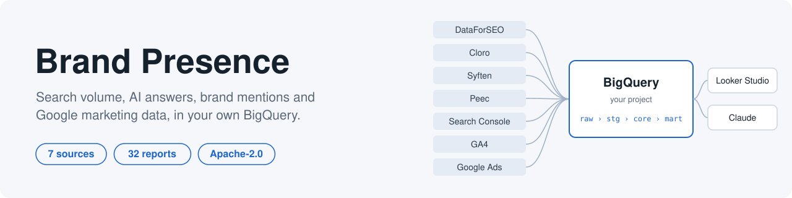
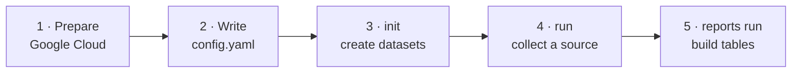
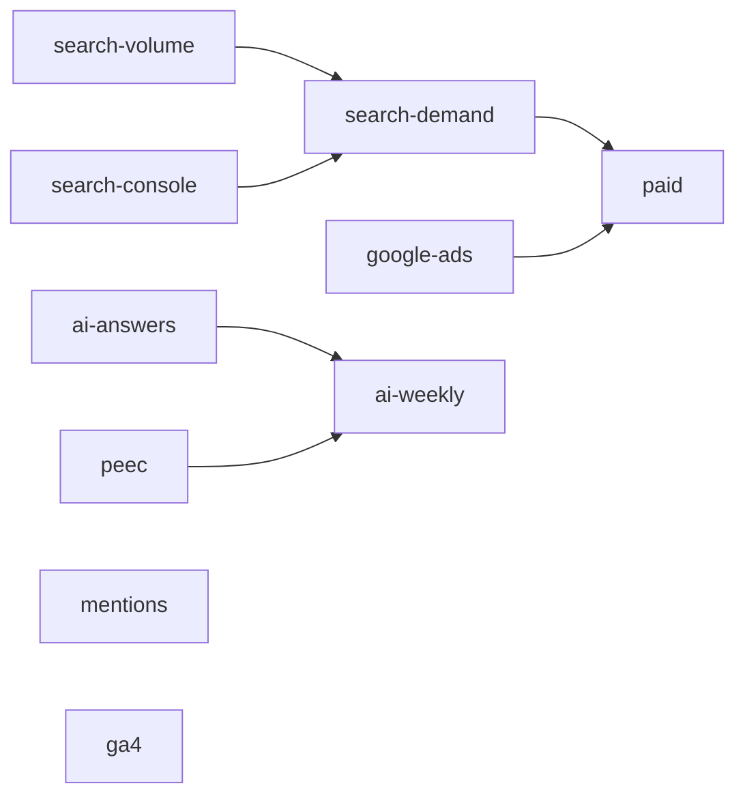
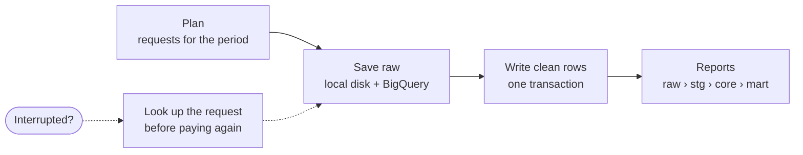

<picture>
  <source media="(prefers-color-scheme: dark)" srcset="docs/images/hero-dark.svg">
  
</picture>

<p align="center">
  <a href="LICENSE"></a>
  
  
</p>

<p align="center">
  <a href="#try-it-in-one-minute">Try it</a> ·
  <a href="#run-it-on-your-own-project">Set up</a> ·
  <a href="#sources">Sources</a> ·
  <a href="#reports">Reports</a> ·
  <a href="#how-a-run-works">How it works</a> ·
  <a href="#documentation">Docs</a>
</p>

Brand Presence is a command-line kit for analysts and marketing teams. It pulls data
from seven sources, cleans it, and builds 32 versioned reports in BigQuery. You own the
project, the data and the credentials.

| | |
| --- | --- |
| 🗄️ **Your project** | Everything lands in datasets in your own Google Cloud project. |
| 💸 **Pay once** | Raw responses are saved first, so an interrupted run resumes without paying twice. |
| 📝 **Plain setup** | One YAML file. Credentials come only from environment variables. |
| 🧪 **Try first** | A built-in example runs every report on invented data, offline. |

Point Looker Studio at the tables, or give Claude access through your own BigQuery
connection. The kit does not include a dashboard or a scheduler.

## Try it in one minute

No Google Cloud project, credentials, vendor account or network needed. You need
[uv](https://docs.astral.sh/uv/getting-started/installation/) and Git, on macOS or Linux.
Clone this repository, then run from its folder:

```sh
uv python install 3.12
uv sync --locked
uv run brand-presence example --output example-output
```

```text
fct_search_volume_v1: 6 rows -> /…/example-output/fct_search_volume_v1.csv
search_volume_history_v1: 6 rows -> /…/example-output/search_volume_history_v1.csv
...
32 reports, 155 rows. HTML: /…/example-output/report.html
```

Open `example-output/report.html` for three views: search volume trend, AI answer brand
share and mentions by week. Every report is also written as a CSV. The command never
overwrites files, so use a new or empty directory.

The [example inputs and expected outputs](src/brand_presence/example/README.md) list the
fixed dates and known figures. Tests compare every report CSV exactly.

## Run it on your own project



### 1. Prepare Google Cloud

- Install the [Google Cloud CLI](https://cloud.google.com/sdk/docs/install).
- Use a project with billing and the BigQuery API enabled.
- Give your user **BigQuery User** and **BigQuery Data Editor** on the project. See
  [BigQuery roles](https://docs.cloud.google.com/bigquery/docs/access-control).

```sh
gcloud auth application-default login
```

### 2. Write your config

```sh
cp example.yaml config.yaml
```

Set at least these keys. Every key is described in [configuration](docs/configuration.md).

| Key | Value |
| --- | --- |
| `project_id` | Your Google Cloud project. |
| `client_id` | A stable name of your own, such as `aardvark-research`. `example` is rejected. |
| `location` | One BigQuery location for all datasets, such as `EU`. |
| `brands`, `countries`, `benchmark_sets` | Your brands, countries and keywords instead of the invented ones. |

> [!IMPORTANT]
> Keep `client_id` unchanged once you start. It is part of every request key, so
> changing it pays again for the current period.

### 3. Create the datasets

```sh
uv run brand-presence init --config config.yaml
```

`init` is safe to repeat. It creates missing datasets and tables and never deletes data.

### 4. Collect a source and build its reports

Start with one source. For DataForSEO:

```sh
export DATAFORSEO_LOGIN='example-login'
export DATAFORSEO_PASSWORD='example-password'
uv run brand-presence run search-volume --config config.yaml
uv run brand-presence reports run --config config.yaml
```

Collection and reports are separate commands. Neither schedules future runs. For other
sources, follow their guide in the table below.

## Sources

Every command starts with `uv run brand-presence`. Every live run also needs BigQuery
access through Application Default Credentials (ADC). BigQuery bills storage and
queries separately.

| | Source | Collect | Credentials | Cost | Live-tested |
| --- | --- | --- | --- | --- | :---: |
| 🔎 | [DataForSEO](docs/sources/dataforseo.md) | `run search-volume` | `DATAFORSEO_LOGIN`, `DATAFORSEO_PASSWORD` | US$0.06 per task | ✅ |
| 🤖 | [Cloro](docs/sources/cloro.md) | `run ai-answers` | `CLORO_API_KEY` | Credits per task | ✅ |
| 💬 | [Syften](docs/sources/syften.md) | `run mentions` | `SYFTEN_API_KEY` | Subscription | ✅ |
| 🤖 | [Peec](docs/sources/peec.md) | `run peec` | `PEEC_API_KEY` | Subscription, reads are free | Offline only |
| 📈 | [Search Console](docs/sources/search-console.md) | `run search-console` | ADC | Free API, quotas apply | ✅ |
| 📊 | [GA4](docs/sources/ga4.md) | `run ga4` | ADC | Free API, quotas apply | ✅ |
| 📣 | [Google Ads](docs/sources/google-ads.md) | `run google-ads` | `GOOGLE_ADS_*` variables | Free API, quotas apply | ✅ |

Every source is tested offline with invented data. ✅ means it also ran against live
accounts and BigQuery in November 2026, with all its report groups built. Check your
first run against your own account.

Search Console and GA4 read their APIs by default. If a property already exports to
BigQuery, you can read that export instead, per property. See
[API or BigQuery export](docs/bigquery-export.md). The export route is tested offline
only.

**Not included yet:** CRM sources, the Syften archive backfill, and reports that depend
on Ads Transparency, search results, Trends or Reddit labels. The full list is in
[reports](docs/reports.md#reports-not-included).

## Reports

Build a report group after collecting its source:

```sh
uv run brand-presence reports run --source ai-answers --config config.yaml
```



| `--source` | Builds |
| --- | --- |
| `search-volume` (default) | Monthly search volume facts and history |
| `ai-answers` | Cloro prompt results, monthly brand counts and citations |
| `mentions` | Syften mention facts |
| `peec` | Peec prompt results, monthly brand counts and citations |
| `ai-weekly` | Weekly brand mentions, domain citations and AI overview presence, from Cloro and Peec |
| `search-console` | Search Console monthly totals and query facts |
| `ga4` | GA4 monthly facts, engagement and page reports |
| `google-ads` | Delivery, keywords, search terms, auction, history and modifiers |
| `search-demand` | Search demand and growth, from search volume and Search Console |
| `paid` | Monthly paid comparisons, adding Google Ads |

Each group builds its prerequisites and checks in one transaction. A failed build rolls
back. Table names and caveats are in [reports](docs/reports.md).

## How a run works



1. **Plan.** The run reads your config and works out which requests the period needs.
2. **Save raw.** Each vendor response is saved to local disk and BigQuery before parsing.
3. **Write clean rows.** Rows are replaced by request key in one transaction, never merged.
4. **Recover.** A request interrupted mid-send is looked up before it is paid for again.

> [!WARNING]
> Raw files live under `.brand-presence/` next to your config. They contain your
> research terms and vendor responses, so treat the folder as private data and back it
> up. Use one machine and one state folder per project. Details are in
> [recovery](docs/recovery.md).

<details>
<summary><strong>Exit codes</strong></summary>

| Code | Meaning |
| --- | --- |
| `0` | Success |
| `1` | Nothing completed, or an error |
| `2` | Invalid command usage |
| `3` | Partial completion. Run the same command again later. |

</details>

## Limitations

- No scheduler and no dashboard.
- Search volume is national and monthly.
- Weekly API and Peec windows are not refreshed after they succeed, so late vendor
  changes are not picked up.
- An empty report does not prove a brand had no activity.
- Sentiment and recommendation labels are not inferred.
- Distinct users and ratios cannot be added across report rows.
- First runs are slow on large accounts. Search Console history takes a few minutes per
  week, and Syften reads every filter in your account.
- Peec and the BigQuery export routes have not been run against live accounts yet.

## Documentation

| Page | What it covers |
| --- | --- |
| [Configuration](docs/configuration.md) | Every YAML key and its rules |
| [Sources](docs/sources/) | Setup, cost and behaviour per source |
| [Google sign-in](docs/google-auth.md) | ADC scopes and OAuth clients |
| [API or BigQuery export](docs/bigquery-export.md) | Reading GA4 and Search Console exports |
| [Reports](docs/reports.md) | Report tables, caveats and what is left out |
| [Recovery](docs/recovery.md) | Local state, locks and paid-request recovery |
| [Decisions](docs/adr/) | Why the kit works the way it does |

## Contributing and support

See [CONTRIBUTING.md](CONTRIBUTING.md) for development setup and tests. Report bugs and
request features in GitHub Issues. Include the command, package version and a redacted
error. Never attach credentials, account IDs, raw responses or private configuration.
For vulnerabilities, follow [SECURITY.md](SECURITY.md).

## License

[Apache-2.0](LICENSE)
